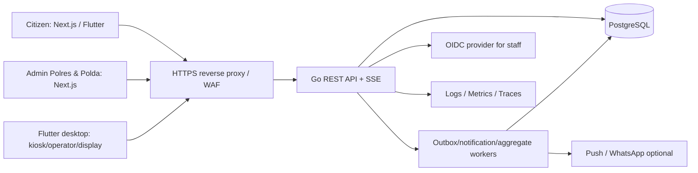

# 01 — Arsitektur Bersama, Multi-Tenancy dan RBAC SIBATANG


> **KEPUTUSAN CAKUPAN v2 (mengikat):** Platform ini **hanya untuk Polda Jawa Tengah**. Hari pertama produksi hanya **Polres Batang (brand publik: SIBATANG)** sebagai tenant dan **dashboard pengawasan Polda Jawa Tengah**. Polres lain di Jawa Tengah boleh di-*onboard* kemudian, setelah otorisasi; **tidak membangun platform nasional, tidak menerima Polda lain, tidak menampilkan tenant fiktif di produksi**. Nama institusi pada paparan tertulis “Polresta Batang”, sedangkan arahan pemilik produk “Polres Batang”; nomenklatur/legal owner harus divalidasi sebelum seed produksi. Kode teknis awal menggunakan `POLRES_BATANG`.


## 1. Tujuan dan batasan

SIBATANG sesuai paparan menghubungkan pendaftaran publik, layanan SPKT/laporan kehilangan, SKCK, SIM, STNK, BPKB, kiosk check-in/cetak, loket, display, notifikasi dan dashboard (slide 2, 4–8). Dokumen ini menambahkan struktur untuk *multiple Polres ONLY within Polda Jawa Tengah*, bukan hanya instalasi tunggal.

**Aturan utama:** *UI hides features; API enforces permission; database enforces tenant boundary.* Masing-masing tenant dapat memiliki banyak lokasi, tiap lokasi memiliki beberapa jenis layanan dan loket.

## 2. Context dan deployment awal



**Bounded modules** dalam satu modular monolith: `identity`, `organization`, `tenancy`, `catalog`, `scheduling`, `booking`, `checkin`, `queue`, `devices`, `notification`, `reporting`, `audit`.

- **Pilot SIBATANG Batang dan monitoring Polda Jateng sejak hari pertama**: sejak migrasi pertama ada node Polda (supervisor), node Polres Batang/tenant, RLS, Polda user, **dashboard Polda aggregate aktif**, dan satu/lebih audio zone Flutter Desktop. 1 Go API process, 1 worker bila perlu, 1 PostgreSQL, 1 Next server, TLS proxy, registered devices. Database dengan backup teruji. *Single instance* bukan HA; jangan sebut HA sebelum redundansi selesai.
- **Perluasan Polres di Jawa Tengah**: 2+ API replicas stateless, PostgreSQL HA/backups, load balancer sticky-free SSE, separate workers and reporting read model; Redis hanya jika data dan uji beban membuktikan perlu. Tidak melakukan distributed transactions secara prematur.
- **Data residency**: persetujuan lokasi data dan vendor sebelum production. Integrasi pihak ketiga wajib disetujui.

## 3. Struktur organisasi dan definisi tenant

```text
POLDA_JAWA_TENGAH (satu root organisasi, dashboard supervisor)
├── POLRES_BATANG (SATU-SATUNYA TENANT PRODUKSI SAAT PILOT)
│   └── TENANT_SIBATANG_BATANG
│       ├── Site: SPKT/SKCK
│       ├── Site: SATPAS (SIM, jika disahkan)
│       └── Site: SAMSAT (STNK/BPKB, jika disahkan)
└── [POLRES_LAIN_JATENG] (onboarding MASA DEPAN, belum produksi)
    └── [TENANT_POLRES_BARU]

# Staging hanya: POLRES_UJI_B (sintetis di bawah Jateng) untuk test RLS
# TIDAK ADA: root POLRI, Polda kedua, tenant nasional, federation lintas provinsi
```

**Catatan:** batas hierarki Polda Jateng → Polres Jateng merupakan keputusan produk; rincian nama resmi institusi, kode, dan kepemilikan/kewenangan SATPAS/SAMSAT harus divalidasi sebelum seed produksi. Slide 5 hanya menetapkan bahwa lokasi pelayanan terpisah, **bukan** perizinan integrasi sistem instansi lain.

| Konsep | Id | Pemilik | Akses |
|---|---|---|---|
| Organization | `org_id` | Polda Jawa Tengah → Polres Jateng | Relasi Polda→Polres, validasi kewenangan |
| Tenant | `tenant_id` | Polres | Batas isolasi data transaksi dan operasional |
| Site | `site_id`, `tenant_id` | Polres | Lokasi fisik SPKT/SKCK, SATPAS, SAMSAT |
| Service | `service_id` global + `tenant_service_id` | Katalog & tenant | Layanan tiap site, konfigurasi form/kuota |
| Counter | `counter_id`, `site_id`, `tenant_id` | Lokasi | Satu/multi service di loket tertentu |
| User membership | `user_id`, `role_id`, `scope_type`, `scope_id` | Identity service | Satu staf bisa punya beberapa penugasan |
| Registered device | `device_id`, `tenant_id`, `site_id` | Site administrator | Kiosk/display/operator device only |

**Tenant ID dari client bukan bukti kewenangan**. API menentukan keanggotaan yang valid dari identitas terverifikasi dan relasi organisasi; selector tenant yang dipilih dalam UI wajib diotorisasi ulang server-side.

## 4. RBAC + scoped resources (hibrida RBAC/ABAC)

Permission convention: `domain.resource.action`, misalnya `queue.ticket.call`, `report.aggregate.read`, `tenant.user.manage`. Effective permission = role grants ∩ allowed scope ∩ resource tenant/site/service ∩ any service policy.

### 4.1 Role v1

| Role | Scope maksimum | Aksi utama | Larangan eksplisit |
|---|---|---|---|
| `PLATFORM_ADMIN` | Platform internal | bootstrap dan konfigurasi infrastruktur | Tidak otomatis dapat PII/booking citizen |
| `POLDA_ORG_ADMIN` | Polda Jawa Tengah & descendant Polres | onboarding Polres via approval, Polda memberships, standar delegasi | Tidak otomatis mengelola data warga atau call ticket |
| `POLDA_MONITOR` | Polda Jawa Tengah & descendant Polres | statistik lintas Polres, agregasi pelayanan | Tidak melihat NIK/HP/nama/QR warga |
| `POLDA_SUPERVISOR` | Polda Jawa Tengah & descendant Polres | monitoring dan pengaturan standar *yang didelegasikan* | Tidak call queue lintas Polres, tidak ekspor raw PII |
| `POLRES_ADMIN` | Tenant Polres | user, site, service, jadwal, loket, devices, report | Tidak boleh mengakses tenant Polres lain |
| `SITE_MANAGER` | Site | jadwal lokasi, loket, operasional, laporan lokasi | Tidak mengelola lokasi lain |
| `SERVICE_OPERATOR` | Tenant+site+service/counter | call-next, recall, start service, complete/no-show | Tidak ubah roles, slot capacity, tenant |
| `RECEPTION_CHECKIN` | Site+services assigned | scan, verifikasi, check-in, reprint terbatas | Tidak call counter yang tidak ditugaskan |
| `REPORT_VIEWER` | Tenant/site | report non-PII / aggregated | Tidak booking edit atau operator actions |
| `DEVICE_KIOSK` | Exact tenant+site+device | check-in/token redeem dan cetak melalui service khusus | Tidak dapat query semua bookings/users |
| `DEVICE_DISPLAY` | Exact tenant+site+display | read sanitized live queue | Tidak dapat citizen detail atau mutate |
| `DEVICE_ANNOUNCER` | Exact tenant+site+audio zone+device | klaim/ack job TTS terbatas, nama panggilan hanya bila diizinkan | Tidak dapat mutate antrean, enumerate warga, lintas zone |
| `CITIZEN` / `GUEST` | Own booking/public service | create/view/cancel own booking | Tidak dapat melihat booking orang lain |

Boleh ada tambahan role, tetapi **jangan** menyimpan string role di frontend sebagai satu-satunya kontrol. Semua role diubah menjadi permission grants yang diuji.

### 4.2 Permission matrix contoh minimum

| Permission | POLDA_MONITOR | POLRES_ADMIN | SITE_MANAGER | SERVICE_OPERATOR | KIOSK |
|---|---|---|---|---|---|
| `report.aggregate.read` | descendants | own tenant | own site | - | - |
| `report.detail.read` (anonymized) | bila kebijakan membolehkan | own tenant | own site | - | - |
| `site.config.manage` | - | own tenant | own site delegated | - | - |
| `schedule.manage` | - | own tenant | own site | - | - |
| `booking.checkin` | - | own tenant | delegated | assigned desk only | own device/site only |
| `queue.ticket.call` | - | own tenant (break-glass tracked) | own site | assigned counter | - |
| `queue.display.read` | - | own tenant | own site | assigned site | own site |
| `tenant.member.manage` | - | own tenant | - | - | - |
| `device.enroll` | - | own tenant | delegated own site | - | - |
| `announcement.policy.manage` | - | own tenant | delegated own site | - | - |


**Announcer device permission:** only `DEVICE_ANNOUNCER` can call `announcement.claim` and `announcement.ack` on its enrolled zone; no human staff role or kiosk may claim speech jobs.

### 4.3 Aturan request yang berlaku pada semua endpoint privat

1. Autentikasi token/session; validasi signature, issuer, audience, expiry, revocation/suspension.
2. Cari memberships aktif di database/cache singkat yang invalidatable, jangan percaya `role` dari input user.
3. Tetapkan `tenant_id` dan scope sumber daya dari record database, bukan dari UUID yang disamarkan.
4. Validasi permission + hubungan organisasi (`is_descendant`) bila operasi report Polda.
5. Query tenant-aware; bagi tenant tables atur PostgreSQL RLS sebagai lapis keamanan kedua.
6. Tulis security/audit log untuk aksi mutasi penting dan supervisor access. `403` untuk permission ditolak; `404` untuk sumber daya sensitif yang tidak boleh diketahui keberadaannya (pilih kebijakan konsisten).
7. Semua export, SSE subscriptions, websocket (jika ada), object storage, cache, jobs dan analytics memakai aturan scope yang sama.

**Penugasan lintas tenant:** staf Batang dan staf Polres Uji B (staging) memerlukan dua membership berbeda; tidak pernah memperoleh akses hanya dengan mengganti header tenant.

### 4.4 Model RBAC yang direkomendasikan

```text
users(id, subject_external, status, ...)
organizations(id, parent_id, type, code, name, ...)
tenants(id, owning_org_id UNIQUE, code UNIQUE, status, timezone)
roles(id, code UNIQUE, is_system)
permissions(id, code UNIQUE)
role_permissions(role_id, permission_id)
user_memberships(id, user_id, role_id, scope_type, scope_id,
                 starts_at, expires_at, status)
membership_service_scopes(membership_id, tenant_service_id) -- optional fine-grain
```

`scope_type` is validated enum `JATENG_PLATFORM | POLDA_JATENG | TENANT | SITE | COUNTER | AUDIO_ZONE` (service scopes held separately). Policy evaluation is server-owned; deny on unknown type. Store org closure table (`org_ancestors`) or materialized path for authorized descendant queries; updates require audited hierarchy migration.

## 5. Isolation layer dan reporting Polda

- **Transactional**: `bookings`, `tickets`, `checkins`, `queue_events`, `counters`, `schedule_slots`, `forms`, `devices`, `audit_events` carry `tenant_id` and site where applicable. Use composite foreign keys or verified join patterns that ensure references belong to the same tenant.
- **DB**: normal role `sib_api` minimal privileges + RLS. Administrative migrator credentials **not** used by API. Set transaction-local tenant (`SET LOCAL`/`set_config(..., true)`) each transaction; no pooled session leakage. Always test RLS and `FORCE ROW LEVEL SECURITY` where appropriate.
- **Supervisor reporting**: write separate `daily_service_metrics` / `hourly_queue_metrics` aggregates including `tenant_id`, `site_id`, `service_id`, timestamp, counts, wait metrics. Only `POLDA_*` endpoints may perform authorized **read-only** descendant queries. Aggregation queries must be via a dedicated checked repository + audit, not bypass ordinary RLS from all endpoints.
- **Sensitive info**: no PII in Polda metrics, caches or export by default; add small-cell suppression thresholds when needed to avoid re-identification, including filters/drilldown.
- **Storage & logging**: partition keys `tenant_id/site_id`; audit contains actor/scope/action/outcome/correlation, **not** NIK/QR/raw token. Signed uploads require per-tenant scope and short expiry.
- **Rate limit**: by IP, principal, tenant, device and path for fairness. Prevent one tenant exhausting shared queue/worker pools.

## 6. End-to-end operational state machines

### Booking

```text
CONFIRMED → CHECKED_IN
     ↘ CANCELLED
     ↘ EXPIRED (after configured grace window)
```

The **booking** state machine ends at check-in; the **queue ticket** has its own state machine and determines progress through waiting, called and served. UI can merge these into a citizen timeline. A walk-in creates an immediate intake record and ticket via an atomic backend workflow with origin `WALK_IN`. QR identifies booking but **ticket/nomor antrean is issued after successful check-in** (slide 4/6); prevent duplicate issuance.

### Queue ticket

`WAITING → CALLED → SERVING → COMPLETED`; `CALLED → WAITING` via authorized requeue policy; `CALLED → NO_SHOW`; `WAITING → CANCELLED`. Every transition is validated by backend; immutable event log records what happened. Never regenerate ticket numbers after issuance or reassign a number to another person.

**Display status**: only prefix/nomor antrean, counter and service; no names, NIK, phone, case descriptions or sensitive form contents.

## 7. Security minimum yang tidak dapat ditunda

- HTTPS (TLS supported), secrets in secret manager/env injected securely; encrypted backups, least-privilege database and separate deploy identities.
- Staff: OIDC + MFA for Polda/admin; short sessions, revocation, step-up auth for high-risk changes. Public citizen sign-in optional where policy allows, privacy-first booking token.
- Citizen ownership: random high-entropy secret for access to own booking (`booking_reference` alone insufficient); QR contains opaque secret / signed token with expiry and audience. Display/URL tokens redact from logs; use rate limits.
- Use CSRF protection for cookie-backed state-changing web requests, secure HttpOnly SameSite cookie, strict CORS for bearer APIs, CSP, output escaping, input validation and file upload allowlist/size/antivirus scanning when needed.
- Device enrollment: one-time short-lived activation code authorized by site admin; rotating per-device credentials bound to site/role; endpoint revocation and inventory, *no embedded master API key in Flutter builds*.
- PII retention by class/service, encryption at rest and in transit, data subject request workflow, approved deletion/anonymization, backup retention. Compliance review for UU PDP and institutional records retention; implementation guidance not legal opinion.
- Audit on role/scope changes, settings, ticket overrides, Polda report reads/exports and all sensitive form accesses. Separate break-glass roles with reason, expiry, 2-person approval where required.
- Scheduled security review: OWASP ASVS, OWASP API security risks (particularly BOLA), SAST/SCA, secrets scan and penetration test before public exposure.

## 8. Observability and operations

- `request_id`, `trace_id`, `tenant_id`, `site_id`, `actor_id` in *structured logs* **without raw PII**.
- KPIs: arrivals/hour, served/hour, no-show rate, cancellation rate, median/p95 waiting time, queue depth, device heartbeat, printer failure, notification failure, booking-to-checkin conversion.
- Alerts: API 5xx and latency, DB errors/capacity, outbox backlog, kiosk/device offline, printer failures, SSE disconnections, tenant-scope violation attempts, backup restore failure.
- Monitoring Polda: reports show metrics by Polres→site→service, freshness timestamp and delay indicator; **operational metrics are not a source of authority** to mutate individual Polres queues.
- RPO/RTO pilot targets to be approved by sponsor. Example *design goal* RPO <= 15 min, RTO <= 4 h after proven by restore drills; not a guaranteed SLA until validated.

## 9. ADR untuk ekspansi

| Decision trigger | Tindakan setelah ada bukti |
|---|---|
| SSE + database event fanout melampaui limit atau koneksi banyak lokasi | Introduce message broker / fanout layer without rewriting domain state |
| Reporting Polda memberatkan OLTP | Dedicated read replica/materialized views/analytics store; authorization tetap eksplisit |
| Perangkat kiosk perlu offline printing | Per-site edge agent dengan lease/idempotent sync *setelah* threat model dan reconciliation teruji; no unsynchronized duplicate tickets |
| Tenants perlu physical isolation karena kebijakan | Deploy by Polda cluster or DB-per-Polda dengan same API contract dan control-plane registry |
| Vendor identity mandatory | Adapt OIDC provider, jangan implement custom identity password system tanpa keharusan |

## 10. Definition of Done keamanan

- [ ] Tulis tes automated `POLRES_A cannot read/write POLRES_B` untuk seluruh data class dan endpoint, termasuk SSE/export/file upload.
- [ ] `POLDA_JATENG` melihat agregat Batang pada pilot; Polres Uji B hanya staging; tak ada data Polres non-descendant/PII.
- [ ] Every mutating request checks scoped permission, not only authenticated flag.
- [ ] RLS role ordinary app cannot `BYPASSRLS`, DB ownership/migration separation diuji.
- [ ] Every query/event/cache key contains verified scope, jobs re-check scope.
- [ ] Booking/checkin/call-next race simulation menghasilkan 0 double booking dan 0 nomor antrean duplikat.
- [ ] MFA, emergency access, backup restore dan device revocation end-to-end tested.

**Kaitannya:** lihat [`03_BACKEND_GOLANG.md`](03_BACKEND_GOLANG.md), [`06_API_DATA_CONTRACT.md`](06_API_DATA_CONTRACT.md) dan [`07_ROADMAP_TESTING_OPERATIONS.md`](07_ROADMAP_TESTING_OPERATIONS.md).


## 11. Perubahan wajib MVP: suara otomatis + Polda-Jateng-from-day-one

- **Hierarki Polda sudah berjalan pada pilot SIBATANG**, tidak ditahan sampai phase multi-Polres: login `POLDA_MONITOR`/`POLDA_ORG_ADMIN`, dashboard metrics Batang, tenant provisioning flow dan audit. Tenant sintetis kedua berada hanya di staging untuk cross-tenant suite.
- Tambah `queue_audio_zones(tenant_id, site_id, ...)` dan perangkat `DEVICE_ANNOUNCER` khusus zone; per lokasi seperti SPKT/SKCK, SATPAS, SAMSAT punya routing berbeda. Polres admin mengelola voice config; Polda hanya statistik perangkat tanpa public call name.
- `queue.ticket.call`/backend `AUTO_ADVANCE_ON_READY` mencatat `queue_event` + `queue_announcement` + outbox dalam transaksi yang sama. SSE hanya mengirim job-ready; private announcer API memberi nama terbatas berdasarkan policy layanan.
- Dua otomasi berbeda: `AUTO_ANNOUNCE_ON_CALL` (selalu ketika nomor dipanggil) dan `AUTO_ADVANCE_ON_READY` (hanya jika loket siap, staffed, eligible ticket). Tidak ada hardcoded timer berdasarkan jam booking.
- **Audio leader/lease/fencing** menjamin hanya satu claim owner aktif per zone, best-effort dedup fisik dan FIFO playback. Kesalahan TTS tidak membatalkan panggilan backend/display, tetapi memicu alarm dan SOP manual.
- `PREFERRED_NAME_IF_CONSENT` dan `NUMBER_ONLY` adalah opsi kebijakan per site/service. Default aman `NUMBER_ONLY` sampai dasar pemrosesan/pengumuman nama disetujui resmi; sesudah disetujui nama dapat diumumkan otomatis melalui endpoint private, bukan display publik.

**Normative implementation:** `09_AUTOMATIC_QUEUE_VOICE.md`, `10_POLDA_FIRST_PILOT.md`.

## 12. Aturan geografis yang tidak boleh diubah tanpa keputusan produk baru

- Root organisasi **hanya** `POLDA_JAWA_TENGAH`. Tabel boleh generik untuk rekayasa perangkat lunak, **namun API provisioning memvalidasi satu root resmi Jateng dan tidak menyediakan pembuatan Polda lain**.
- Polres Batang selalu default publik pada fase pilot; dashboard Polda menampilkan tepat satu Polres aktif. Jangan gunakan selector provinsi/Polda pada mobile, kiosk atau homepage awal.
- Perluasan hanya `POLRES_*` di bawah root Polda Jateng. Kode branding/tema layanan nanti per tenant; `SIBATANG` milik Batang, bukan brand wajib untuk tenant lainnya.
- Pengujian isolasi memakai tenant sintetis Polres Uji B **di staging dalam Polda Jateng**. Tidak ada skenario lintas Polda yang harus dibangun sekarang.
- Setiap usulan fitur multi-Polda, pusat/nasional, atau otorisasi lintas wilayah adalah **di luar cakupan** dan memerlukan dokumen persetujuan baru; jangan memasukkan ke migration, screens, service flags atau onboarding default.
