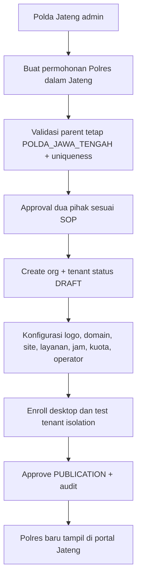

# 10 — Pilot Polres Batang + Monitoring Polda Jawa Tengah dari Hari Pertama

**Status:** keputusan final scope v2, P0 pada MVP. **Wilayah deployment: hanya Jawa Tengah.**

## 1. Batas wilayah, identitas dan tenant

```text
PUSAT PLATFORM OPERASIONAL JAWA TENGAH (satu environment)
└── POLDA_JAWA_TENGAH [supervisor / organization root]
    ├── POLRES_BATANG [PRODUCTION - PILOT]
    │   └── TENANT_SIBATANG_BATANG [pemilik data operasional]
    │       ├── SITE_SPKT_SKCK [SPKT/laporan kehilangan + SKCK]
    │       ├── SITE_SATPAS [SIM] (publikasi setelah izin/validasi)
    │       └── SITE_SAMSAT [STNK/BPKB] (publikasi setelah izin/validasi)
    └── POLRES_LAIN_JATENG [MASA DEPAN - belum dibuat sebagai tenant produksi]
```

- **Brand SIBATANG hanya untuk Polres Batang**. Dashboard Polda dapat memakai identitas generik `Monitoring Pelayanan Polda Jawa Tengah`; Polres lain kelak boleh diberi branding sendiri.
- Slide 1–9 memakai kata **Polresta Batang**; permintaan final pemilik produk memakai **Polres Batang**. Periksa nomenklatur resmi sebelum hostname/domain/logo/seed produksi; identifier teknis pilot `POLRES_BATANG` tidak bermakna penetapan hukum.
- Hari pertama ada **tepat satu tenant publik aktif**: Batang; Polda bukan tenant transaksional. Staging dapat mempunyai tenant `POLRES_UJI_B` sintetis di bawah Polda Jateng.
- Tidak ada node Polda lain, struktur nasional, dan mekanisme onboarding lintas provinsi. Kolom parent fleksibel hanya untuk relasi Polda Jateng -> Polres Jateng.
- Zona waktu deployment Jawa Tengah `Asia/Jakarta` (WIB); simpan event UTC dan service-day `Asia/Jakarta`.

## 2. Apa yang harus operasional sebelum pilot

| Komponen | MVP Batang (wajib) | Polda Jateng (wajib) |
|---|---|---|
| Akun/staf | admin Polres dan petugas lokasi/loket | POLDA_ORG_ADMIN dan POLDA_MONITOR dengan MFA |
| Data layanan | booking, check-in, antrean, formulir konfigurasi | angka total/antrian aktif/performa agregat Batang |
| Aplikasi | website + desktop kiosk/operator/display/announcer | dashboard web monitoring Polres Batang |
| Multi tenant | seluruh transaksi bertenant `TENANT_BATANG` | verifikasi hubungan organisasi Jateng/descendant |
| Ekspansi | tidak mengaktifkan Polres fiktif | menu onboarding Polres **Jateng saja**, draft-only sampai approved |
| Audit | aksi loket, admin, device | audit akses laporan dan onboarding |

**Kebijakan privasi:** dashboard Polda hanya dapat melihat metrik agregat, kesehatan perangkat, perbandingan antar-unit saat tersedia. Tidak mendapatkan nama, NIK, HP, token booking, formulir warga, atau endpoint mutasi tiket.

## 3. Bootstrap konkret

```yaml
platform_region_code: JAWA_TENGAH
organization_root:
  code: POLDA_JAWA_TENGAH
  type: POLDA
  region: JAWA_TENGAH
pilot_tenant:
  org_code: POLRES_BATANG
  tenant_code: SIBATANG_BATANG
  pilot: true
  published: true # setelah UAT dan approval
  timezone: Asia/Jakarta
  branding:
    product_name: SIBATANG
    owner_label: Polres Batang # cek nomenklatur sebelum go-live
future_polres:
  allowed_parent: POLDA_JAWA_TENGAH
  create_automatically: false
  publish_automatically: false
```

**Urutan:** (1) seed Polda Jateng, (2) seed org Polres Batang, (3) tenant Batang + konfigurasi `branding`, (4) site dan service draft sesuai paparan, (5) roles & memberships nyata, (6) enroll devices per site/audio zone, (7) reporting materialization + Polda dashboard, (8) uji E2E, (9) publish Batang. Seed production tidak boleh memuat user/password contoh, NIK, atau Polres fiktif.

## 4. Onboarding Polres Jateng berikutnya (fungsional sejak pilot, belum mengaktifkan tenant baru)



Minimal endpoint:

```text
GET  /api/v1/polda/jateng/polres
GET  /api/v1/polda/jateng/metrics
POST /api/v1/polda/jateng/onboarding-requests
GET  /api/v1/polda/jateng/onboarding-requests
POST /api/v1/polda/jateng/onboarding-requests/{id}/approve
POST /api/v1/polda/jateng/onboarding-requests/{id}/reject
GET  /api/v1/staff/tenants/{tenantId}/readiness
POST /api/v1/staff/tenants/{tenantId}/publish
```

Approval bisa menjadi Polda-side delegated approver atau operations platform menurut SOP yang disahkan. Semua fungsi hanya boleh membuat child organisasi root **Polda Jawa Tengah**; jangan menerima `parent_id` arbitrer dari client.

## 5. Dashboard Polda pilot real, bukan mock

Route: `/polda/jateng/overview`, `/polda/jateng/polres`, `/polda/jateng/polres/[tenantId]`, `/polda/jateng/onboarding`, `/polda/jateng/devices`, `/polda/jateng/audit`.

Panel pilot hanya menampilkan **Batang**: total booking, kedatangan, menunggu, dipanggil, selesai, batal, tidak hadir, per layanan/site; rata-rata dan p95 waktu tunggu; jumlah printer/kiosk/announcer online; error voice; waktu data terakhir diperbarui (`as_of`). Angka kosong `0` harus dibedakan dari data belum tersedia/stale. Metrik jumlah Polres aktif = 1 pada awal produksi; jangan mengarang angka tenant lain.

Sumber data: view/agregasi read-only terikat `tenant_id` yang divalidasi sebagai descendant `POLDA_JAWA_TENGAH`. Audit setiap export/perubahan filter sensitif. Jangan men-cache snapshot dashboard tanpa scope key.

## 6. Isolasi dan otorisasi

- `POLDA_MONITOR` / `POLDA_SUPERVISOR`: `report.aggregate.read` dan `device.health.aggregate.read` untuk descendants Polda Jateng; **tanpa** `booking.read_sensitive` atau `queue.ticket.call`.
- `POLDA_ORG_ADMIN`: organisasi/onboarding Jateng, bukan kontrol otomatis data warga atau loket.
- `POLRES_ADMIN`: admin Batang pada pilot, tidak ada kuasa otomatis atas tenant lain.
- `SERVICE_OPERATOR`: mutasi antrean hanya counter yang ditugaskan pada tenant/site yang valid.
- `DEVICE_ANNOUNCER`: menerima `public_call_name` hanya untuk audio zone miliknya, sesuai policy yang disahkan; speaker umum tetap berisiko privasi sehingga default nama dimatikan sampai izin.
- `JATENG_PLATFORM_ADMIN`: operasional deployment/provision; tidak otomatis bisa baca PII.

**Enforcement:** OIDC/MFA staf; membership DB; Go scope checks; `tenant_id` immutable; PostgreSQL RLS; deny-by-default; audit. Jangan menganggap filter Next.js aman sendirian.

## 7. UAT wajib pada pilot

| ID | Uji | Kriteria lulus |
|---|---|---|
| JT-01 | Polda Jateng login | Halaman overview terbuka dan hanya Batang nyata |
| JT-02 | Polres Batang login | Bisa konfigurasi hanya tenant Batang |
| JT-03 | Polda dashboard | Agregat Batang akurat, ada `as_of`, nama/NIK tidak pernah tampil |
| JT-04 | Web publik | Hanya layanan Batang yang telah dipublikasikan, brand SIBATANG |
| JT-05 | Operator dan announcer | Panggilan real-time pada loket Batang bersuara di audio zone benar |
| JT-06 | Tenant uji B (staging) | Staf Batang ditolak membaca/menulis B; Polda melihat agregat Batang+B dalam staging |
| JT-07 | Provision unknown root | Ditolak membuat Polda baru atau Polres parent bukan Jateng |
| JT-08 | Revoke Polda monitor | SSE, export dan seluruh read API ditolak setelah revocation |
| JT-09 | Polda mencoba tiket warga | `403/404`; tidak ada detail pribadi pada API, SSE atau HTML |
| JT-10 | Tenant baru draft | Belum tampil publik sampai approval dan readiness/publish terpenuhi |
| JT-11 | Resiliensi | Koneksi putus tidak menyebabkan tiket/giliran dobel atau audio double speaker |

## 8. Rencana perubahan saat ekspansi Jateng

Saat Polres Jateng kedua benar-benar masuk: (1) approve org, (2) create tenant draft, (3) set branding dan lokasi, (4) delegasi operator/site, (5) aktivasi printer/speaker, (6) tes isolasi, (7) publish, (8) dashboard Polda mulai tampilkan perbandingan nyata. **Tidak melakukan replatforming atau fork kode SIBATANG**. Perubahan menjadi multi-Polda/nasional eksplisit **out of scope**.

**Referensi internal:** `01_ARCHITECTURE_TENANCY_RBAC.md`, `09_AUTOMATIC_QUEUE_VOICE.md`, `11_DATABASE_SCHEMA_SQL.md`, `12_API_OPENAPI_EXAMPLES.md`, `14_UAT_SECURITY_TEST_CASES.md`.
