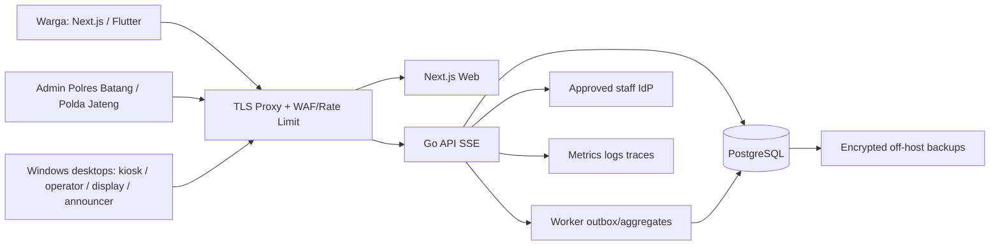

# 13 — Deployment, Environment, Network, Backup dan Runbook

> Satu deployment operasional **wilayah Polda Jawa Tengah**; **tenant produksi awal hanya SIBATANG Batang**. Lingkungan staging terpisah dari production dan berisi data uji sintetis.

## 1. Topologi



**App deployment:** modular monolith Go, Next standalone app, PostgreSQL + one worker (could share same Go binary), reverse proxy. **Device site:** registered Windows kiosk + QR scanner + thermal printer, operator, TV display, single active announcer per audio zone with dedicated speaker. All devices use TLS and device-scoped credentials, no direct DB. Third-party WhatsApp and maps are **optional integrations**, never hard dependencies for check-in/queue.

## 2. Repo deployment structure suggestion

```text
infra/
  docker/
    Dockerfile.api
    Dockerfile.web
    compose.staging.yml
    compose.production.yml
  reverse-proxy/
  migrations/
  deploy/
    release.sh
    smoke-test.sh
    rollback.md
  monitoring/
    alert-rules.md
  backups/
    backup-and-restore.md
```

Never store `.env` with secrets in Git. Use runtime secrets manager or restricted env provisioning. Minimize images and run as non-root. `frontend` should only be reachable via proxy, `api` from proxy/site, `postgres` private isolated network.

## 3. Environment contract (`.env.example` without secrets)

```dotenv
APP_ENV=production
PLATFORM_REGION_CODE=JAWA_TENGAH
ROOT_ORG_CODE=POLDA_JAWA_TENGAH
DEFAULT_PUBLIC_TENANT_CODE=SIBATANG_BATANG
ALLOWED_NEW_POLRES_PARENT_CODE=POLDA_JAWA_TENGAH
APP_TIMEZONE=Asia/Jakarta
WEB_PUBLIC_URL=https://<approved-web-host>
API_PUBLIC_URL=https://<approved-api-host>
DATABASE_URL=<inject-from-secret-manager>
OIDC_ISSUER_URL=<approved-idp>
OIDC_CLIENT_ID=<assigned-id>
OIDC_CLIENT_SECRET=<inject-from-secret-manager>
SESSION_SIGNING_KEY=<inject-from-secret-manager>
QR_TOKEN_SIGNING_KEY=<inject-from-secret-manager>
DATA_ENCRYPTION_KEY=<inject-from-key-service>
OTEL_EXPORTER_OTLP_ENDPOINT=<internal-observability-endpoint>
LOG_LEVEL=info
SSE_HEARTBEAT_SECONDS=20
ANNOUNCEMENT_LEASE_SECONDS=30
ANNOUNCEMENT_EXPIRE_SECONDS=90
BACKUP_STORAGE_URI=<approved-encrypted-offsite-target>
```

Any secret/hostname in this example is a placeholder, **not** a usable production configuration. SIBATANG may use a dedicated domain/subdomain chosen by institution; deployment cannot assume a domain from paparan. Secret rotation/revocation is documented.

## 4. Pre-production gate

- [ ] Security architecture approved; asset inventory and data flow reviewed by Polda and Polres owner.
- [ ] Official nomenclature confirmed: pilot user says **Polres Batang**, paparan says **Polresta Batang**.
- [ ] Actual ownership/permissions for SPKT/SKCK vs SATPAS/SAMSAT confirmed; publishing only authorized sites/services.
- [ ] PostgreSQL migration applied; one Polda Jateng root and exactly one public Batang tenant; no production test Polres.
- [ ] OIDC staff, MFA admins, user membership + RLS negative tests green.
- [ ] Hardware lab test Windows TTS id-ID, chosen printer, QR scanner, speaker, display, reconnection.
- [ ] Privacy and retention set for each service; public name announcement approval or fallback number-only.
- [ ] Staging contract/E2E, dependency security scan, basic load test, accessible web/mobile.
- [ ] Backup restore drill passed, logs have no raw PII, no internet-facing DB/admin port.
- [ ] Polda aggregate Batang dashboard active and reports `as_of`; response access audited.

## 5. Provisioning/production bootstrap order

1. Provision approved server/network, NTP, storage, TLS certificates, DNS, firewall, reverse proxy.
2. Configure secrets and OIDC outside Git; create service database role without superuser/BYPASSRLS.
3. Apply migrations sequentially, create only Polda Jawa Tengah root, Polres Batang org, Batang tenant in `DRAFT`.
4. Seed five **catalog types** SPKT/KEHILANGAN, SKCK, SIM, STNK, BPKB; publish only verified site/service mapping.
5. Grant named Polres admin/operator and named Polda Jateng monitor/admin (no shared password).
6. Enroll site devices and zone, register printer/scanner/speaker inventory, calibrate local Indonesian TTS.
7. Configure service hours, capacity, consent/privacy, optional auto-call with staffed readiness.
8. End-to-end test booking → QR → scan → print → display → voice → served → Polda dashboard.
9. Approve `tenant.status=PUBLISHED` for Batang, launch public web/mobile as phased release.
10. Begin monitoring. Only later, approval-gated onboarding **Polres lain di Jawa Tengah**.

## 6. Minimum CI/CD gates

| Gate | Command/process example | Fail policy |
|---|---|---|
| Backend | `go test ./... -race`, SQL migrations, OpenAPI contract | Required |
| Web | `pnpm lint && pnpm typecheck && pnpm test` + Playwright | Required |
| Flutter | `flutter analyze && flutter test` + Windows build smoke | Required |
| Database | RLS tenant A/B tests, race booking/queue tests | Required |
| Security | SAST, SCA/SBOM, secret scan, MFA/CSRF checks | Required |
| Artifacts | Signed artifacts / protected branch / image digest | Required |
| Prod deploy | Migrate with rollback/forward-fix plan; canary one Batang site | Approval |

Patch/runtime upgrades follow controlled dependency review; do not auto-deploy framework major versions or blindly update Flutter plugins on speaker kiosk PCs.

## 7. Site SOP and resilience

**Start of shift:** verify site code, login assigned operator, counter assignment, audio-zone active announcer and audible test with synthetic text, printer paper, scanner, kiosk/display online, network latency and NTP.

**Queue operations:** staff ready → backend auto-call (if enabled) → local Flutter desktop voices call → display updates → citizen proceeds → staff start/complete. If unstaffed/paused, no auto-call. One active announcer per zone with lease+fencing.

**Printer problem:** ticket already persisted; retry `reprint` exact original number with audit. No locally generated queue IDs.

**Internet/API outage:** show offline, do not accept bookings/check-ins offline without approved reconciliation mode. Use approved manual paper fallback; on recovery enter exceptions with supervisor and audit.

**Audio outage:** keep queue state, show red health and allow authorized manual verbal announcement. Never silently replay outdated name/number after restart.

**Device compromised:** remotely revoke device identity, isolate from VLAN, rotate keys, incident response.

**Polda dashboard stale:** show stale marker and last update; do not substitute zero/assume data is current.

## 8. Backup, recovery and scaling

- DB: encrypted full backups plus PITR/WAL if approved, distinct backup account/host, restricted restore keys, retention reviewed under data policy.
- RPO/RTO targets are **planning only** until measured restoration drill; example RPO 15 minutes / RTO 4 hours is **not an SLA**.
- Test at least one isolated restore before go-live, then periodic drills with validated tenant boundaries and job dedupe.
- Initial infra sizing must be validated with traffic estimates and load tests; vertical scale first; message broker/Redis/Kubernetes only when measured bottleneck justifies it.
- 2+ API replicas can share database and SSE; must preserve resumable event stream, central device leases and outbox semantics. Horizontal scaling is **within Jateng platform**, not new Polda deployment.

## 9. Logging and monitoring

- Structured logs carry `request_id`, timestamp, tenant/site/device IDs and redacted identity; **never** QR secrets, NIK, telephone, raw forms or audible name text.
- Metrics: booking success, slot conflicts, queue depth, check-in latency p95, audio job delay/failures, printer errors, kiosk heartbeat, Polda metrics freshness, DB lag, backup age and restore test.
- Alerts route to Polres site operation owner for physical devices; regional Polda platform operator for aggregate/backend outages. Escalation/RACI written before live.
- Distinguish platform uptime from external provider status (maps/WhatsApp) and from actual audio heard (ACK only shows player completed).

## 10. Documentation to hand over

Delivery bundle includes infra as code, secured config sample, secrets inventory (not secret values), data classification/retention table, architecture and threat model, OpenAPI, migration plan, device installation SOP, operations runbook, rollback/restore, QA evidence with logs/screenshots, named ownership contacts, training checklist, and approval letters as applicable.
