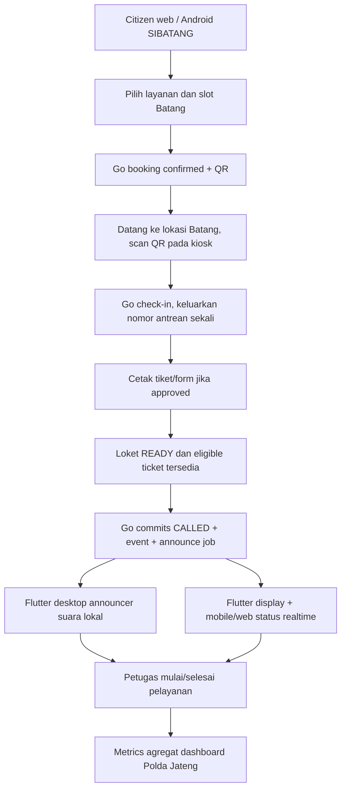

# SIBATANG — Full Implementation Blueprint v2.0

**Scope resmi rancangan:** Pilot **Polres Batang** dengan nama publik **SIBATANG**. Platform terpusat dan pengawasan hanya **Polda Jawa Tengah**. Seluruh kemungkinan ekspansi dibatasi pada **Polres lain di Jawa Tengah**, tidak mencakup provinsi/Polda lain dan bukan platform nasional.  
**Tanggal:** 24 Oktober 2026. **Asal kebutuhan:** paparan `paparan system antrian polresta batang.pdf` (9 slide) dan koreksi/penegasan pemilik produk.  
**Jenis paket:** 18 dokumen **Markdown** yang bisa dijadikan instruksi team lead/coding agent. Ini **planning + spesifikasi**; bukan source code aplikasi jadi, bukan migrasi produksi final, dan belum merupakan persetujuan operasional instansi.

## 1. Cakupan yang benar

```text
ONE JAWA TENGAH PLATFORM
└── Polda Jawa Tengah [pengawas, dashboard agregat dari hari pertama]
    ├── Polres Batang [SATU-SATUNYA PILOT PRODUKSI]
    │   └── Tenant SIBATANG_BATANG [brand masyarakat: SIBATANG]
    │       ├── SPKT + SKCK
    │       ├── SATPAS / SIM     (aktif hanya setelah approval)
    │       └── SAMSAT / STNK+BPKB (aktif hanya setelah approval)
    └── Polres lain wilayah Jateng [tenant MASA DEPAN, bukan produksi pilot]

Staging boleh menambah POLRES_UJI_B sintetis hanya untuk tes isolasi.
TIDAK ADA: Polda lain, pusat nasional, lintas provinsi, ataupun tenant fiktif produksi.
```

Paparan menggunakan label **“Polresta Batang”**, sedangkan pemilik produk sekarang meminta **“Polres Batang”**. Seluruh kode awal memakai `POLRES_BATANG`; nama legal yang benar perlu diverifikasi sebelum tayang publik. **Brand SIBATANG tidak diwajibkan kepada Polres Jateng lain**.

## 2. Download structure / indeks file

| File | Owner | Hasil yang harus diimplementasikan |
|---|---|---|
| [01_ARCHITECTURE_TENANCY_RBAC.md](01_ARCHITECTURE_TENANCY_RBAC.md) | Architect + Security | modul, single-Polda Jateng, tenant Polres, RBAC/RLS, isolation |
| [02_WEB_NEXTJS.md](02_WEB_NEXTJS.md) | Web | citizen SIBATANG + admin Polres Batang + dashboard Polda Jateng |
| [03_BACKEND_GOLANG.md](03_BACKEND_GOLANG.md) | Backend | modular monolith, booking/QR/queue/announcer/worker |
| [04_FLUTTER_MOBILE.md](04_FLUTTER_MOBILE.md) | Mobile | Android citizen booking, QR, status, notifikasi; iOS opsional |
| [05_FLUTTER_DESKTOP.md](05_FLUTTER_DESKTOP.md) | Desktop | Windows kiosk, operator, TV display, automatic voice |
| [06_API_DATA_CONTRACT.md](06_API_DATA_CONTRACT.md) | Shared | domain API/SSE/status/ownership payload and permissions |
| [07_ROADMAP_TESTING_OPERATIONS.md](07_ROADMAP_TESTING_OPERATIONS.md) | PM/QA | 16-week roadmap, architecture gates, UAT and operations |
| [08_REQUIREMENTS_TRACEABILITY.md](08_REQUIREMENTS_TRACEABILITY.md) | Analyst | source slide → features → approved new requirements |
| [09_AUTOMATIC_QUEUE_VOICE.md](09_AUTOMATIC_QUEUE_VOICE.md) | Backend/Desktop | voice name/number/counter, queue readiness, zone lease and privacy |
| [10_POLDA_FIRST_PILOT.md](10_POLDA_FIRST_PILOT.md) | Platform/Polda dashboard | actual Batang pilot + Jateng-only oversight/onboarding |
| [11_DATABASE_SCHEMA_SQL.md](11_DATABASE_SCHEMA_SQL.md) | Database | SQL starter organization, booking, tickets, RBAC, devices and RLS |
| [12_API_OPENAPI_EXAMPLES.md](12_API_OPENAPI_EXAMPLES.md) | Backend/All clients | endpoint matrix, JSON examples, errors and OpenAPI snippet |
| [13_DEPLOYMENT_RUNBOOK.md](13_DEPLOYMENT_RUNBOOK.md) | DevOps | deployment zones, env contract, security and site runbook |
| [14_UAT_SECURITY_TEST_CASES.md](14_UAT_SECURITY_TEST_CASES.md) | QA | detailed UAT booking, device, voice, RBAC, Jateng, backup |
| [15_SPRINT_BACKLOG_AND_OWNERS.md](15_SPRINT_BACKLOG_AND_OWNERS.md) | PM/Leads | tickets, owner/team assignments, sprint deliverables |
| [16_SCOPE_DECISIONS_REGISTER.md](16_SCOPE_DECISIONS_REGISTER.md) | Product owner | locked scope, open policy decisions, exclusions and change control |
| [AGENTS.md](AGENTS.md) | Developers/Codex | engineering guardrails and definition of done |
| [README.md](README.md) | All | main implementation brief / file index |

## 3. Pembagian produk

- **Next.js web (16.x)**: publik SIBATANG Batang, booking form/QR/status; admin Polres Batang; dashboard Polda Jawa Tengah dengan angka nyata Batang, site/device health dan onboarding future Polres Jateng.
- **Go backend (1.27.x)**: authoritative data dan authorizer, organisasi single-root Jateng, PostgreSQL RLS, booking/slot locking, check-in, queue tickets, announcements, SSE + reporting worker + audit.
- **Flutter mobile stable (3.47.x)**: aplikasi Android SIBATANG; tampilkan katalog Batang; e-ticket QR, status antrean, peta dan informasi; iOS bila disetujui.
- **Flutter Desktop Windows**: kiosk touchscreen & printer/QR; operator loket; layar display ruang tunggu; **announcer TTS** yang otomatis menyebut **nomor + nama yang diizinkan + loket** tanpa tumpang tindih speaker.
- **PostgreSQL 18**: transaksi konsisten, tabel tenant-aware, RBAC+scope, aggregate Polda dari child Polres Jateng yang approved. Polda **bukan** tenant transaksional dan **tidak menerima PII warga** dari default dashboard.

## 4. Alur operasional utama



**Makna otomatis:** announcer otomatis berucap setelah queue call sah dibuat backend, bukan semata jam booking telah lewat. Mode auto-advance dapat diaktifkan **hanya** untuk counter yang staffed, READY, tidak paused/serving dan SOP approved. Jika kebijakan privasi belum mengizinkan penyebutan nama, **voice number-only** sampai persetujuan selesai. Satu announcer aktif tiap audio zone dengan lease/fencing; laporan Polda dan display tidak menerima nama.

## 5. Tabel prioritas

| Kategori | Wajib pilot P0 | Setelah pilot / izin khusus |
|---|---|---|
| Hierarki | Root Polda Jateng, child Batang, RLS, role Polda monitor | onboarding Polres Jateng kedua real |
| Booking | catalog, syarat, slot, QR, check-in, print | digital form kompleks dan integrasi eksternal |
| Queue | operator, auto-ready controlled, display realtime | advanced analytics |
| Voice | Indonesian offline if installed, approved fallback, optional allowed name | advanced voice tuning |
| Dashboard | Batang live-ish aggregate ke Polda Jateng, `as_of` | compare >1 real Jateng Polres |
| Infrastructure | staging/prod secure, backup restore, audit, tested devices | HA after volume proves necessary |
| Integrasi | manual info/services approved | WhatsApp official, AI FAQ, SIM/STNK/BPKB official APIs after authorization |

## 6. Delivery suggestion / cara pakai oleh tim

1. **Product owner + Polda/Polres:** review `16_SCOPE_DECISIONS_REGISTER.md`, approve nomenklatur Polres, legitimate services, name-speaker policy and hosting/legal gates.
2. **Tech lead:** freeze `01_ARCHITECTURE_TENANCY_RBAC.md` and `10_POLDA_FIRST_PILOT.md`; set repo modules, stage environments and ADR.
3. **Backend:** implement `11_DATABASE_SCHEMA_SQL.md`, `03_BACKEND_GOLANG.md`, final OpenAPI based on `06_*`/`12_*`; backend is single source of truth.
4. **Web, mobile, desktop:** implement independently from generated typed API; do not create role authority or auto queue numbers in frontend.
5. **QA/DevOps:** execute `14_UAT_SECURITY_TEST_CASES.md` and `13_DEPLOYMENT_RUNBOOK.md` before go-live; track tickets via `15_SPRINT_BACKLOG_AND_OWNERS.md`.
6. **Coding agent:** copy `AGENTS.md` to repository root, give exact platform MD + API contracts and scope decisions as context.

## 7. Teknologi dan version policy

A conservative Oct 2026 baseline: Next.js 16.3.x + Node.js 24 LTS + TypeScript, Go 1.27.x + `pgx`/`sqlc`, PostgreSQL 18, Flutter stable 3.47.x, REST JSON + SSE, OIDC MFA, Docker / TLS proxy. Pin actual **supported patch versions** in lockfiles and test in CI/real Windows hardware; this document is not a mandate to upgrade production without regression tests. Redis/broker/Kubernetes are not required for pilot.

Official references (verify at implementation time): [Next.js docs](https://nextjs.org/docs/app), [Go downloads/release](https://go.dev/dl/), [Flutter stable archive](https://docs.flutter.dev/install/archive), [PostgreSQL version support](https://www.postgresql.org/support/versioning/), [OWASP ASVS](https://owasp.org/www-project-application-security-verification-standard/).

## 8. Exact definition of pilot done

- Polda Jawa Tengah account can log in to show actual **Polres Batang** aggregate, health, timestamps and auditable access.
- Batang public branded SIBATANG full booking → QR → kiosk → print → operator → display → sound → service end → metrics works on real devices.
- Privacy/RBAC rejects citizen PII for Polda/public display; staging Jateng Polres Uji B cannot access Batang and vice versa.
- Voice renderer calls number/allowed name/loket on Windows local speaker; graceful fallback if language/voice or speaker unavailable.
- No fake production tenant, Polda second root, or national menu; multi-Polres **Jateng** onboarding workflow is built and staging-tested but not published for real until approval.
- Restore drill, security review, service owners and operational runbook accepted; release can be rolled back/reconciled safely.
